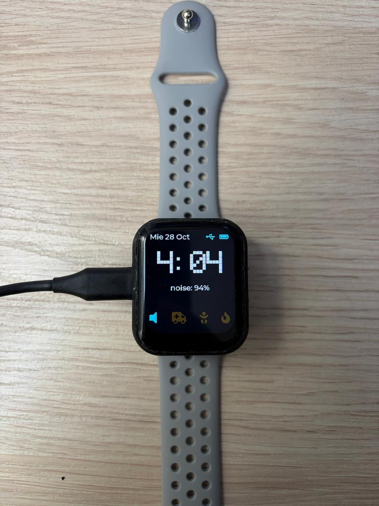
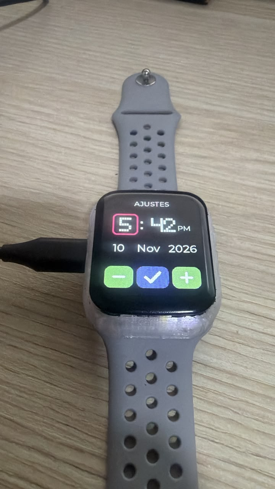

# SignalWatch

**A smartwatch that listens for you.** SignalWatch runs a tiny neural network on an ESP32-C6 to recognize critical sounds (an ambulance, a crying baby, a fire alarm) and alerts the wearer with a message on screen and a Morse-code vibration. It is built for people with hearing loss.


<p align="center">
  
</p>

## Features

- **On-device sound recognition.** An [Edge Impulse](https://edgeimpulse.com) model classifies 1 s of 16 kHz audio from the onboard microphone. Nothing leaves the watch.
- **Three alert classes today:** ambulance, baby crying and fire alarm. Adding a class is one row in [`alert_catalog.c`](smartwatch_project/main/alert_catalog.c).
- **Graded confidence.** A sliding window of predictions turns a score into one of three messages ("Possible...", "It looks like...", "Alert!") so the watch does not cry wolf.
- **Morse vibration.** Each class has its own letter (A, B, F) played on the vibration motor, so you can tell the alert apart without looking.
- **Live feedback on screen:** audio level meter, one icon per class, clock with date, and battery indicator.
- **Always-on clock** backed by a PCF85063 RTC.
- **Screen saver.** The backlight turns off after 30 s without use. A touch, the BOOT button, a class alert or raising the wrist to look at the watch (QMI8658 accelerometer, only watched while the screen is off) turns it back on. The touch or button press that wakes the screen does nothing else, so nothing is pressed by accident.
- **Set the time and date on the watch.** Swipe left on the main screen to open the settings screen, tap hour, minute, month or year to select it, adjust it with the large "-" and "+" buttons (hold to repeat) and tap the red check to save it to the RTC. Swipe right to go back without saving. A very confident alert (above 90 %) takes you back to the main screen on its own.

<p align="center">
  
</p>

## Hardware

| Part | Used for |
|---|---|
| [Waveshare ESP32-C6 1.69" touch LCD watch board](https://www.waveshare.com/) | MCU, 1.69" ST7789 display, CST816 touch, PCF85063 RTC, ES8311 audio codec |
| Vibration motor on GPIO 18 | Haptic alerts |
| LiPo battery | Power (voltage read through the ADC) |

## Build and flash

You need [ESP-IDF v6.0](https://docs.espressif.com/projects/esp-idf/en/latest/esp32c6/get-started/). Managed components (`esp_lvgl_port`, `esp_codec_dev`) are downloaded automatically on the first build.

```bash
cd smartwatch_project
idf.py set-target esp32c6
idf.py build
idf.py -p <PORT> flash monitor
```

A [dev container](smartwatch_project/.devcontainer) is also provided.

## Architecture

The firmware follows SOLID principles. Modules do not know each other: `app_init.c` is the only place that creates them and connects them with callbacks and handles passed by parameter.

```
 microphone ─► ai_module ──(listener callbacks)──► alert_dispatcher ─┬─► ui (queue) ─► ui_task ─► widgets
              capture_task                                           │     clock · battery · vu · alerts · notification
              classify_task ─► ei_wrapper (model)                    └─► vibrator_module (Morse)
                               alert_module (sliding window)
 rtc_module ─────────(callback)────────────────────────────────────────► ui
 battery_module ─────(callback)────────────────────────────────────────► ui
```

- Only `ui_task` draws on the screen. Everything else sends messages through the queue in `ui.c`.
- `alert_catalog` holds the per-class data (label, Morse letter, glyph, texts), so the rest of the code is class-agnostic.
- `app_init.c` documents the initialization order step by step.

| Area | Files |
|---|---|
| Composition root | `app_init.c` |
| Audio and AI | `bsp_es8311`, `ai_module`, `ei_wrapper`, `alert_module`, `alert_catalog`, `alert_dispatcher` |
| Hardware | `display_hw`, `i2c_bus`, `touch_module`, `button_module`, `rtc_module`, `battery_module`, `vibrator_module`, `imu_module` |
| UI | `ui`, `ui_clock`, `ui_battery`, `ui_vu`, `ui_alerts`, `ui_notification`, `ui_settings`, `ui_sleep` |
| Pure logic (unit tested) | `morse`, `rtc_codec`, `battery_math`, `clock_format`, `audio_level`, `audio_preroll`, `time_edit`, `alert_urgent`, `screen_policy`, `wrist_gesture`, plus `alert_module` and `alert_catalog` |

Logic that does not need hardware lives in its own file, so it can be tested on a PC. The hardware modules only call it. `alert_dispatcher` receives its outputs (UI and vibrator) from `app_init.c` instead of including them.

### Screen saver

- `screen_policy`: pure logic that decides when the screen is on. It receives activity and the passing of time, and says when to turn it off. It knows nothing about the backlight or LVGL.
- `display_power.h`: a one-function interface (`on`/`off`). `display_hw` implements it with the backlight; putting the panel to sleep later would not change anything else.
- `ui_sleep`: joins the policy with LVGL (touch inactivity, the shield that swallows the waking touch).
- Wake sources only report "there was activity" through callbacks: `button_module`, the alert dispatcher (`wake_screen` output) and `wrist_wake`. `wrist_gesture` is the pure detector (arm lowered, then raised and held still), `imu_module` is the QMI8658 driver. `app_init.c` connects them and turns the accelerometer on only while the screen is off.

### Setting the time

The time-setting feature is split so that each part can change without touching the others:

- `time_edit`: pure editing state (hour, minute, day, month, year). It is always a valid date, so saving never needs to validate.
- `time_source.h` / `time_sink.h`: neutral read and write interfaces for the time. The RTC implements both today; a WiFi/NTP source could replace it later without changing the UI.
- `ui_settings`: only widgets. It reports abstract inputs (select field, increment, decrement, save), so touch and the physical buttons can drive the same screen.
- `ui.c`: maps those inputs to `time_edit` and writes through the sink. `app_init.c` connects the RTC as source and sink.

All LVGL calls made outside the LVGL task, including widget creation in `ui_start` and the touch registration in `touch_init`, are wrapped in `lvgl_port_lock`.

## Tests

The unit tests run on the PC with gcc and [Unity](https://github.com/ThrowTheSwitch/Unity). They need no board, no ESP-IDF and no FreeRTOS, and they finish in about a second. They cover the logic that can break without anyone noticing:

| Test | What it protects |
|---|---|
| `alert_module` | Alert levels, 3-sample sliding window, per-class history |
| `alert_catalog` | Unique labels, playable Morse text, ASCII-only screen text |
| `morse` | Morse table and the timing of dots, dashes and gaps |
| `rtc_codec` | RTC register decoding and range validation |
| `battery_math` | Voltage to percentage, smoothing filter, charging threshold |
| `clock_format` | 12-hour clock and date text |
| `time_edit` | Editing hour, minute, day, month and year: wrap-around, month lengths, leap years, weekday |
| `alert_urgent` | Which alerts are urgent enough to leave the settings screen |
| `screen_policy` | When the screen turns off and on: timeout, wake, counter wrap-around |
| `wrist_gesture` | Raise-the-wrist detection: lowered arm first, held still, no false triggers |
| `audio_level`, `audio_preroll` | Audio level and the pre-trigger buffer order |
| `alert_dispatcher` | When to vibrate and notify, with fake outputs |

You need gcc, CMake and Ninja. From `smartwatch_project`:

```bash
cmake -S tests -B tests/build -G Ninja
cmake --build tests/build
ctest --test-dir tests/build --output-on-failure
```

On Windows, `tests/run_tests.ps1` does the same and looks for the tools in the usual MSYS2 and ESP-IDF folders. The tests are plain CTest executables, so the Testing panel of VS Code (CMake Tools extension) shows them too.

Every test checks one behavior. Drivers, tasks, queues and drawing are not unit tested: they are checked on the watch.

## Add a new sound class

1. Train or extend the Edge Impulse model with the new label and replace the library in `smartwatch_project/components/ei_model`.
2. Add one row to `CATALOG` in `alert_catalog.c` (label, Morse letter, icon glyph, three texts).
3. Rebuild and run the [tests](#tests). The catalog tests catch a repeated label, Morse text that cannot be played, and accents in screen text (the font has none).

## Roadmap

Planned work is tracked in [Issues](https://github.com/JaimeYesidLeonParada/signalwatch/issues):

- Physical buttons (including editing the time with them)
- Button on the main screen to open the settings
- User-facing battery settings
- More sound classes

Done: set date and time from the watch (touch), LVGL lock when registering the touch input device.

## License

The firmware is released under the [MIT License](LICENSE). The Edge Impulse SDK in `smartwatch_project/components/ei_model` and the fonts keep their own licenses.
